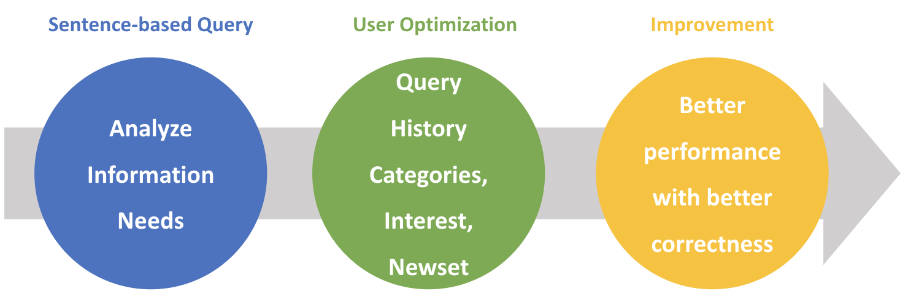
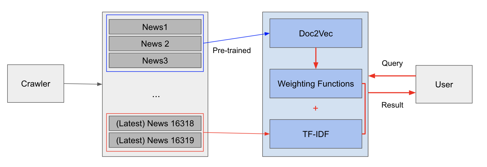

# Hoogle

> **팀 프로젝트 · 개인 보관·정비본**
> 팀 프로젝트로 시작한 기사 검색 코드를 개인 계정에서 보관하고 정비합니다.

Doc2Vec 기반 유사도 검색과 TF-IDF·검색 가중치를 사용해 기사를 찾는 프로젝트입니다.
Django API, React 화면, Nginx·PostgreSQL을 포함한 Docker 구성이 들어 있습니다.

## 현재 상태

- 기존 [소개 화면](docs/images/introduction.png)과 [구조도](docs/images/structure_summary.png)를 보관합니다.
- 공개 라이브 데모 주소와 현재 환경에서의 전체 실행은 확인하지 않았습니다. 아래 실행 안내는 당시 기록입니다.
- 기존 Django CI도 환경 복원 대상입니다. [2026-10-17 실행](https://github.com/edonghyun/hoogle/actions/runs/39017524245)은 Python 3.7 런타임 준비 단계에서 실패했으며 해당 job의 애플리케이션 테스트까지 도달하지 못했습니다.
- 검색 재현에는 기사 데이터와 Doc2Vec 모델 준비가 필요합니다. 기존 의존성은 [requirements.txt](backend/django/requirements.txt)에 고정되어 있으며 이번 정비에서 일괄 업그레이드하지 않았습니다.

## 코드를 읽는 순서

| 관심사 | 위치 |
|---|---|
| 구성과 서비스 연결 | [docker-compose.yml](docker-compose.yml) |
| 검색 API와 가중치 계산 | [article.py](backend/django/api/views/article.py) |
| 모델 학습·저장 | [makedoc2vecmodel.py](backend/django/core/management/commands/makedoc2vecmodel.py) |
| 기사 수집 명령 | [parsearticles.py](backend/django/core/management/commands/parsearticles.py) |
| 검색 화면 | [MainView.js](frontend/react/src/views/MainView.js) |

실행을 복원할 때는 샘플 기사 데이터·모델 생성·DB 초기화·첫 검색 결과를 하나의 절차로 확인할 예정입니다.
검색 정확도나 성능 수치는 재현된 평가 근거를 확보한 뒤 추가합니다.

---

## 기존 실행·설계 기록

## About Hoogle
Doc2vec based news article search engine. Reconstructed with Django Framework.
To increase search engine queality of herald korea, 
especially for multi-words-query such as "death penalty", "Effective ways to educate the people",
Hoogle adopted doc2vec based similarity inferrence search engine model, not searching just by query matching. 
Through below several steps, it catches the meaning of given several words, counts on the user search history and matches information needs of user and qeury results.

## Getting started
    1. clone the repository
    
    2. change directory to the project
    
    3. execute docker-compose with command 'docker-compose up'
    
    4. access http://localhost:18267 through browser     
## Live demo
A current public demo URL has not been verified. See the screenshots above; the previous placeholder URL has been removed.
 
## Architecture
1. user access to hoogle through frontend react.

2. nginx route the http request to django web application.

3. django parse the user input query, tokenize through nlp core engine.

4. nlp engine calculate similarity between pre-parsed articles and user input query.

    4-1. recently parsed articles are calculated with tf-idf, cosine similarity because they are not included in doc2vec model. 

5. weight scores are added to each ranked articles.

6. finally return articles relevant to user input query.

## Core Search Engine
#### Structure
#### Weight Functions

    WEIGHT_SIMILARITY: 
        
    WEIGHT_LATEST: 
        
    WEIGHT_TERM_FREQUENCY:
        
    WEIGHT_IDF:

## Evaluation

    Precision - Query Test
    
    1. "BTS NEW" 
    
    2. "BTS NEW ALBUM"
    
    3. "IMPACT OF BITCOIN ON WORLD"

